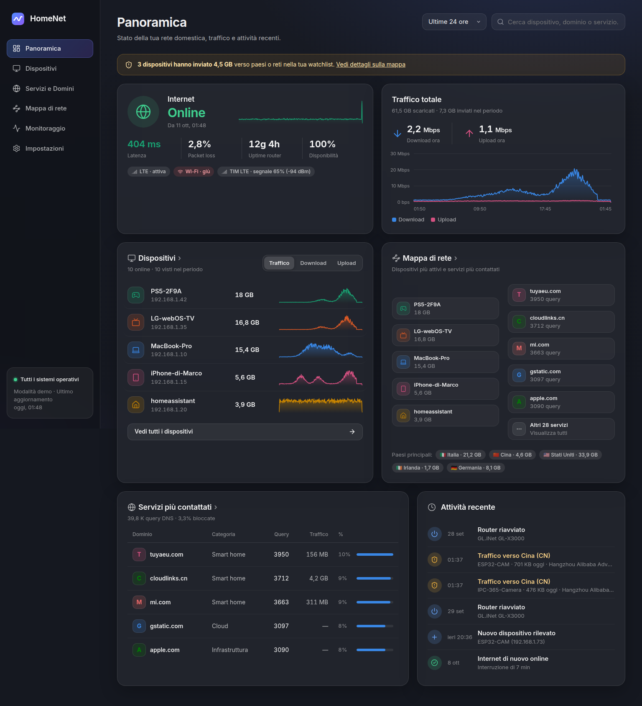
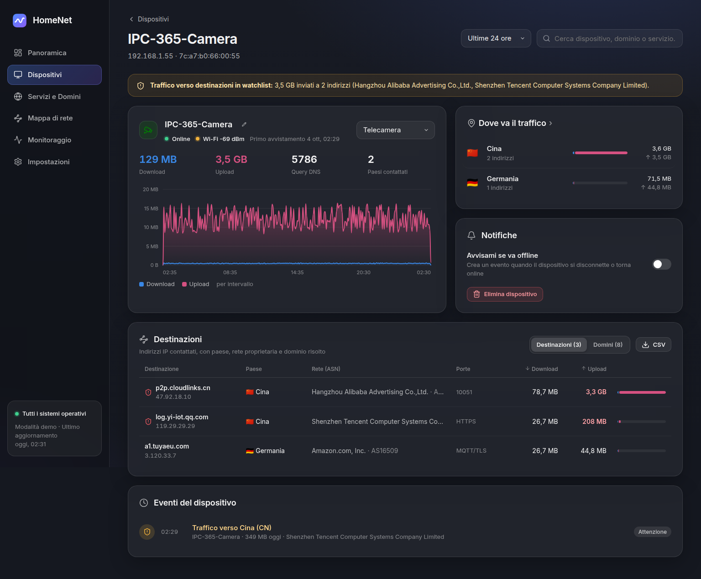
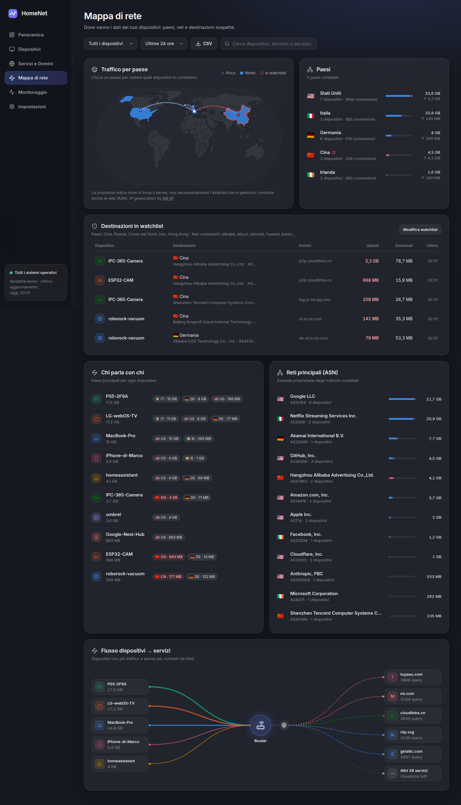
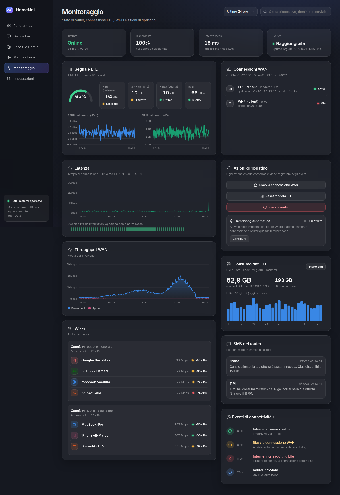

# HomeNet

Self-hosted network watchdog and traffic analytics for Umbrel + OpenWrt + AdGuard Home.



## Features

**Watchdog**
- Internet reachability, latency and packet loss (TCP probes, no extra privileges), availability history.
- WAN status for LTE / Wi-Fi client / Ethernet uplinks, router uptime, CPU and RAM.
- LTE signal: RSRP, RSRQ, SINR, RSSI, operator, band. Read through ModemManager, `uqmi`, or AT commands via `sms_tool`. Graphed over time.
- Wi-Fi radios and every connected client with signal and rate.
- Router SMS (multipart messages are merged).
- Recovery: restart WAN → reset modem → reboot router → optional power-cycle through a Home Assistant smart plug. Manual buttons with confirmation, plus an automatic watchdog (off by default, capped at *N* reboots per 6 h).
- Monthly mobile-data usage per billing cycle, with optional quota and end-of-cycle projection.

**Traffic analytics**
- Bytes per device (5-minute resolution), live per-device rate, and destinations per device. Data comes from router conntrack.
- Domains per device and blocked queries, from the AdGuard Home query log. Destination IPs are labelled with the domain the device just resolved.
- Country and network owner (ASN) of every destination, offline (DB-IP lite), with a world map, "who talks to whom", and top networks.
- **Watchlist alerts** when a device sends data to watch-listed countries (default CN, RU, KP, IR, HK) or to networks whose name matches keywords such as Alibaba / Tencent / Huawei, wherever their servers are.

**Notifications** via ntfy, Telegram or the Home Assistant companion app. You choose which groups to send: internet / WAN, watchlist, new devices, devices offline, watchdog actions. Alerts raised while internet is down are queued and delivered when it comes back.

**umbrelOS widgets**: live status (internet, latency, download, devices online) and data usage on the Umbrel home screen.

| Device detail | Map | Monitoring |
|---|---|---|
|  |  |  |

## How it works

```
 OpenWrt router                          Umbrel (Mac mini)
 ┌──────────────────────────┐   ubus    ┌───────────────────────────────┐
 │ rpcd plugin "homenet"    │◄──HTTP(S)─┤ HomeNet (Node, 1 container)   │
 │  · conntrack byte deltas │           │  · collectors every 10–60 s   │
 │  · hosts, Wi-Fi, WAN     │           │  · SQLite (WAL) + rollups     │
 │  · modem signal, SMS     │           │  · DB-IP lite GeoIP/ASN       │
 │  · reboot / ifup actions │           │  · React UI via app_proxy     │
 └──────────────────────────┘           └──────────────┬────────────────┘
                                         AdGuard Home ─┘ /control/querylog
```

- The router does almost nothing. The plugin reads `/proc/net/nf_conntrack` and emits only the **byte deltas** of flows that changed since the last poll; its state is kept in RAM under `/tmp`. The `conntrack` CLI is used if the proc file is missing.
- HomeNet maps flows to devices (DHCP leases + neighbour table, IPv4 and IPv6) and looks up country/ASN offline.
- Storage is pre-aggregated:
  - 5-minute counters per device
  - hourly rows per device × destination (capped at 400 destinations per device per hour; the rest is folded per country so totals stay exact)
  - hourly DNS counts
  - hourly and daily rollups per device × country/network and per device × service
  - one sample per minute for connectivity
  - one row per day per WAN interface
- Data older than the retention window (default **15 days**, 3–30) is deleted every 6 hours, and the space is returned with `incremental_vacuum`.

### Resource use

- Measured in demo mode: about 90 MB RAM and ~0% CPU when idle.
- Database size depends on how many distinct destinations your devices contact: a few MB per week for a typical home of ~10 devices.
- Worst case benchmark (`npm run bench`): 30 devices × 150 distinct destinations every hour for 15 days, i.e. 1.6M flow rows, ~190 MB on disk. Every page answers in **30–450 ms** on a modern CPU (expect 2–3× on a 2011 Mac mini). Responses for long ranges are cached for 1–2 minutes.

## 1. Router setup (OpenWrt)

From the project folder on your computer:

```sh
scp -O router/* root@192.168.1.1:/tmp/
ssh root@192.168.1.1 sh /tmp/install.sh 'choose-a-password'
```

The script:
- installs `uhttpd-mod-ubus`, `jsonfilter` (and `conntrack` if needed) when missing
- copies the plugin to `/usr/libexec/rpcd/homenet`
- enables conntrack byte accounting
- creates an RPC user `homenet` that can **only** call the `homenet` object (other ubus calls such as `system.reboot` are denied)

It ends with a self-test. Tested on OpenWrt 23.05 and 24.10. To remove everything: `sh /tmp/uninstall.sh`.

**LTE signal and SMS.** Edit `/etc/homenet.conf` on the router. `MODEM_METHOD=auto` tries ModemManager, then `uqmi`, then AT commands through `sms_tool` (`AT_DEVICE=/dev/ttyUSB2`). AT parsing understands 3GPP `+CSQ`/`+CESQ`/`+COPS`, Quectel `+QENG`/`+QNWINFO` and Huawei `^HCSQ`.

**HTTPS.** If your router forces HTTPS (luci-ssl), HomeNet follows the redirect and accepts the router's self-signed certificate.

> If **flow offloading** is enabled in the firewall, offloaded connections may stop updating conntrack counters, and per-device traffic will be under-reported. HomeNet shows a warning when it detects this.

## 2. AdGuard Home

Per-device DNS stats need clients to query AdGuard directly. In OpenWrt set *Network → Interfaces → LAN → DHCP Server → Advanced → DHCP-Options* to `6,<umbrel-ip>`. If the router forwards DNS to AdGuard instead, every query appears to come from the router.

On Umbrel, AdGuard runs on the host network, so the default URL `http://host.docker.internal:8095` works from the HomeNet container. Tested against AdGuard Home v0.107.57 and v1.0.0-b.1.

## 3. Install on Umbrel

1. Push this repo to GitHub and tag a release (`git tag v0.1.0 && git push --tags`). The workflow builds `ghcr.io/<you>/homenet` for amd64 and arm64. Make the package public.
2. Replace `OWNER` in `umbrel/ruggero-homenet/*.yml` with your GitHub user, and put the `umbrel/` folder in a repo of its own (a community app store).
3. In Umbrel: *App Store → ⋯ → Community App Stores →* add the store repo URL, then install **HomeNet**.
4. Open HomeNet → **Impostazioni** and fill in:
   - router URL, user `homenet` and the password you chose
   - AdGuard credentials

   Use *Verifica connessione* for both. Optionally set your data plan, notifications and Home Assistant.

Quick test without the store: `docker build -t homenet .` then
`docker run -d -p 3000:3000 -e TZ=Europe/Rome -v homenet-data:/data --add-host host.docker.internal:host-gateway homenet`.

## Development

```sh
cd server && npm install && npm run dev     # DEMO=1: simulated router + AdGuard + 7 days of history
cd web && npm install && npm run dev         # http://localhost:5173 (proxies /api to :3000)
cd server && npm test                        # parsers, collectors, watchdog, notifications
cd server && npm run bench                   # load test on a large synthetic database
```

`DEMO=1` back-fills a week of synthetic traffic, so every screen can be developed offline. The demo data includes a camera uploading to Alibaba Cloud in China.

## Notes & limits

- Country = where the **server** is, not the company: a Chinese camera may upload to Alibaba Cloud in Frankfurt. That is why the watchlist also matches ASN names.
- Flows that start and finish between two polls (15 s) lose their last delta. Long-lived uploads (cameras, backups) are captured accurately.
- The watchdog is **off by default**. If the router itself freezes, it cannot reboot itself: enable the Home Assistant smart-plug option for that case.
- Set `TZ` (done in the Umbrel compose file) so that days and billing cycles follow your local time.

IP geolocation by [DB-IP](https://db-ip.com) (CC BY 4.0).
